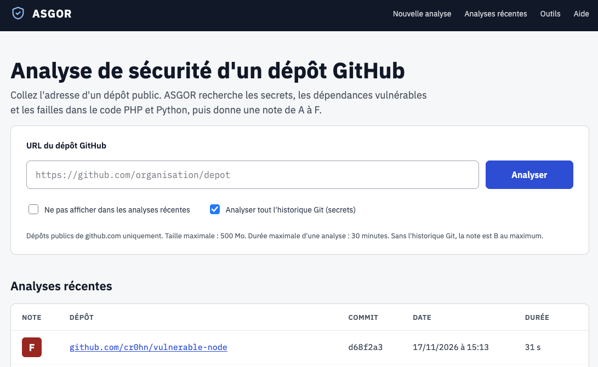

# ASGOR

*Automated Security Grading Of Repositories* : analyse de sécurité de dépôts GitHub, auto-hébergée, avec une note de A à F.

On colle l'adresse d'un dépôt GitHub public, l'analyse tourne, on obtient une **note globale de A à F**, une note par domaine (Secrets, Dépendances, Code) et la liste des problèmes, avec pour chacun ce qu'il faut faire. Le fonctionnement s'inspire de [SSL Labs](https://www.ssllabs.com/ssltest/).

- **Auto-hébergé** : aucun code ni résultat n'est envoyé à un service extérieur.
- **Prudent** : aucun code du dépôt analysé n'est exécuté, aucune de ses configurations n'est utilisée, chaque étape tourne dans un environnement isolé.
- **Langages** : PHP en priorité (Symfony, Laravel), Python, et les dépendances npm, pnpm, yarn, Composer et pip.



---

## Avertissement

ASGOR est un outil d'aide à l'audit. Ses résultats peuvent être incomplets ou comporter des erreurs (faux positifs, failles non détectées). Ils ne constituent pas une certification de sécurité.

ASGOR ne modifie jamais les dépôts analysés. En revanche, le script de correction des dépendances du dépôt [asgor-tools](https://github.com/brahimmachkouri/asgor-tools) **modifie le dépôt** sur lequel il est lancé, et **une mise à jour de dépendance peut casser l'application** : lisez l'avertissement de son README avant de l'utiliser.

Ce logiciel est fourni « tel quel », sans garantie d'aucune sorte (voir [`LICENSE`](LICENSE)). Les exclusions de garantie et limitations de responsabilité de la licence s'appliquent dans les limites autorisées par le droit applicable.

---

## Sommaire

1. [Avertissement](#avertissement)
2. [Ce que fait ASGOR](#ce-que-fait-asgor)
3. [Fonctionnement](#fonctionnement)
4. [Outils utilisés](#outils-utilisés)
5. [Options des outils](#options-des-outils)
6. [Notation](#notation)
7. [Sécurité](#sécurité)
8. [Installation](#installation)
9. [Utilisation](#utilisation)
10. [Développement et tests](#développement-et-tests)
11. [Organisation du dépôt](#organisation-du-dépôt)
12. [Limites actuelles et évolutions](#limites-actuelles-et-évolutions)
13. [Licence](#licence)

---

## Ce que fait ASGOR

Pour un dépôt `https://github.com/<propriétaire>/<dépôt>`, ASGOR cherche :

| Domaine | Ce qui est cherché |
|---|---|
| **Secrets** | clés, jetons et mots de passe dans les fichiers et dans tout l'historique Git |
| **Dépendances** | bibliothèques avec des failles connues (CVE, GHSA), d'après les fichiers de verrouillage |
| **Code** | injections SQL, XSS, injections de commande, fonctions dangereuses (PHP et Python) |

Le rapport affiche :

- la note globale, le score et la lettre de chaque domaine, et les raisons d'un éventuel plafonnement ;
- les problèmes, du plus grave au moins grave, avec fichier, ligne, outil, explication et correction ;
- pour chaque secret : une valeur masquée (4 caractères puis `****`) et un lien « Voir sur GitHub » vers la ligne exacte, au bon commit ;
- une rubrique « Qualité du code » (PHPStan), sans effet sur la note ;
- l'historique des analyses du dépôt ;
- des exports **JSON** et **SARIF**.

L'équipe peut **écarter un faux positif**, avec un motif obligatoire. Le résultat écarté ne compte plus dans la note, reste visible à part (date, adresse IP, motif) et peut être rétabli.

Le script `corriger_dependances.py`, publié à part dans le dépôt [asgor-tools](https://github.com/brahimmachkouri/asgor-tools), lit un export JSON et met à jour les dépendances vulnérables du dépôt, sur une branche Git à part. ASGOR lui-même ne modifie jamais les dépôts analysés.

---

## Fonctionnement

```text
Navigateur ──HTTPS──> reverse proxy (Caddy) ──> asgor-web (compte asgor-web)
                                                    │ dépose une demande
                                                    v
                                          /var/lib/asgor/file/
                                                    │ relevée toutes les 2 s
                                                    v
                                     asgor-worker (root, seul à écrire)
                                                    │ chaque étape via asgor-sandbox
                                                    v
                    clonage (profil fetch) ──> outils (profil scan, sans réseau)
                                                    │
                                                    v
                       fusion, notation, rapport JSON + SARIF, base SQLite
```

1. Le **service web** (FastAPI, gabarits Jinja2, sans JavaScript) valide la demande et la dépose dans une file. Il lit la base en lecture seule et ne lance jamais d'analyse lui-même.
2. Le **worker** relève la demande, la revérifie champ par champ et lance le moteur. Une seule analyse à la fois.
3. Le **moteur** (Python, bibliothèque standard seulement) clone le dépôt, repère les langages et les fichiers de dépendances, installe les dépendances PHP sans scripts ni plugins, lance les outils, fusionne les résultats (un problème vu par deux outils ne compte qu'une fois), calcule la note et écrit le rapport. Le dossier de l'analyse est supprimé à la fin.

---

## Outils utilisés

Versions épinglées (version exacte et somme SHA256, signatures vérifiées quand elles existent) :

| Domaine | Outil | Rôle |
|---|---|---|
| Secrets | Gitleaks 8.30.1 | fichiers et historique Git, avec une règle ASGOR pour les tableaux PHP |
| Dépendances | Composer Audit (Composer 2.9.5) | dépendances PHP |
| | pip-audit 2.10.1 | dépendances Python |
| | OSV-Scanner 2.7.1 | toutes les dépendances (base OSV) |
| | Trivy 0.76.2 | dépendances, en complément |
| Code | Psalm 7.5.0 | analyse de flux PHP (injection SQL, XSS, injection de commande) |
| | Opengrep 2.0.0 | règles de sécurité PHP et Python ([semgrep-rules](https://github.com/semgrep/semgrep-rules), téléchargées à un commit figé) |
| | Bandit 1.9.4 | sécurité du code Python |
| Qualité | PHPStan 2.3.4 | rubrique « Qualité du code », sans effet sur la note |

Règles de choix des versions :

- jamais « latest », jamais de dépôt APT tiers : la chaîne de publication de Trivy a été compromise en mars 2026 ;
- seulement des versions **publiées depuis au moins 14 jours** : une version toute neuve est la plus exposée à une publication piégée.

---

## Options des outils

Options réellement passées par le moteur (`moteur/asgor_moteur/moteur.py`). Les fichiers de configuration cités sont ceux d'ASGOR (`moteur/conf/`, ou générés par le moteur dans le dossier de l'analyse), jamais ceux du dépôt analysé.

### Ne pas obéir au dépôt analysé (règle 1)

| Outil | Options | Ce qu'elles neutralisent |
|---|---|---|
| Gitleaks | `git src --config gitleaks.toml --gitleaks-ignore-path gitleaksignore --ignore-gitleaks-allow` | `.gitleaks.toml`, commentaires `gitleaks:allow`. Gitleaks lit le `.gitleaksignore` à la racine du dépôt **même avec** `--gitleaks-ignore-path` : le moteur le supprime de sa copie avant de lancer Gitleaks |
| Trivy | `fs --config trivy.yaml --ignorefile "" --scanners vuln` | `trivy.yaml`, `.trivyignore` |
| OSV-Scanner | `scan source --config osv-scanner.toml --no-ignore --recursive --allow-no-lockfiles` | `osv-scanner.toml` ; `--no-ignore` analyse aussi les fichiers listés dans `.gitignore` |
| Opengrep | `scan --config <règles php/python> --taint-intrafile --x-ignore-semgrepignore-files --disable-nosem --no-git-ignore --exclude <dossiers>` | `.semgrepignore`, commentaires `nosemgrep`, `.gitignore` |
| Psalm | `--config=psalm.xml --taint-analysis --no-cache --threads=1` (configuration générée, jamais de `--plugin`) | `psalm.xml` du dépôt et ses plugins ; une annotation `@psalm-suppress` ne masque pas un résultat de l'analyse de flux |
| PHPStan | `php -d disable_functions=proc_open phpstan analyse -c phpstan.neon --error-format=json --memory-limit=3G` (niveau 5, ni `bootstrapFiles`, ni `includes`, ni extension) | `phpstan.neon` du dépôt. PHPStan charge `<dossier courant>/vendor/autoload.php` au démarrage : le moteur le lance depuis le dossier de l'analyse, jamais depuis les sources. `proc_open` désactivé : un seul processus, aucune connexion locale (interdite sans réseau), aucun programme lancé |
| Bandit | `-r src --ini bandit.ini --ignore-nosec` | `.bandit`, `[tool.bandit]` de `pyproject.toml`, commentaires `# nosec` |
| Composer Audit | `audit --locked --no-plugins --no-scripts` sur une copie de `composer.lock` accompagnée d'un `composer.json` vide | la section `config.audit` du `composer.json` du dépôt, qui peut masquer des failles |

### Ne pas exécuter de code du dépôt (règle 2)

| Outil | Options |
|---|---|
| git | `clone --no-recurse-submodules --single-branch --no-tags`, avec `http.followRedirects=false`, `core.symlinks=false`, `core.hooksPath=/dev/null`, `protocol.file.allow=never` |
| Composer | `install --no-scripts --no-plugins --no-interaction --no-autoloader --ignore-platform-reqs --prefer-dist` |
| pip-audit | `-r <fichier> --no-deps --disable-pip` (aucune installation ni résolution de paquets) |
| OSV-Scanner | jamais `--call-analysis` (pour Rust, cette option lance des scripts de compilation) |

### Analyse sans réseau

Les bases de failles sont téléchargées dans le profil `fetch`, puis l'analyse tourne sans réseau dans le profil `scan` :

| Outil | Téléchargement | Analyse hors ligne |
|---|---|---|
| Trivy | `fs --download-db-only` | `--skip-db-update --skip-java-db-update --offline-scan --skip-version-check --disable-telemetry --include-dev-deps` |
| OSV-Scanner | `--download-offline-databases` | `--offline-vulnerabilities` |

### Vérification avec un dépôt piège

Une option acceptée par un outil n'est pas forcément une option qui marche. Le dépôt public [depot-test-analyse](https://github.com/brahimmachkouri/depot-test-analyse) contient des secrets inventés, du code volontairement vulnérable et des fichiers de configuration piégés (avec des fichiers témoins créés s'ils sont exécutés). Il est à analyser après chaque changement du moteur ou d'un outil. Résultat actuel : toutes les configurations piégées sont ignorées, aucun code du dépôt n'est exécuté, les secrets de l'historique sont trouvés.

---

## Notation

- Chaque domaine reçoit un score de 0 à 100 et une lettre. Le barème retire 15 points à chaque doublement du nombre de problèmes ; une dépendance vulnérable compte une seule fois.
- La note globale est la plus basse des trois lettres, puis des plafonnements s'appliquent :

| Constat | Note maximale |
|---|---|
| secret trouvé | F |
| faille critique | F |
| secret « à vérifier » (fichier de test, de documentation, d'exemple) | D |
| injection détectée par l'analyse de flux | C |
| problème moyen, faille élevée corrigeable, fichier de verrouillage absent, historique non analysé ou outil en échec | B |

Un rapport distingue « aucun problème trouvé » d'une analyse incomplète : si un outil échoue, son domaine est marqué « non évalué » et la note ne dépasse pas B.

Règles complètes : [`BAREME.md`](BAREME.md).

---

## Sécurité

### Règles du moteur d'analyse

Le dépôt analysé est traité comme hostile. Ces règles sont obligatoires ; le code y renvoie par leur numéro.

1. **Ne jamais utiliser la configuration fournie par le dépôt analysé** (`psalm.xml`, `phpstan.neon`, `.gitleaks.toml`, `.gitleaksignore`, `.semgrepignore`, `trivy.yaml`, `osv-scanner.toml`…). Ces fichiers peuvent exécuter du code, charger des plugins ou masquer des résultats. ASGOR passe sa propre configuration (`moteur/conf/`) à chaque outil.
2. **Ne jamais exécuter de code du dépôt.** `composer install` uniquement avec `--no-scripts --no-plugins --no-interaction` ; pip-audit sans installation ni résolution de paquets.
3. **Valider l'URL** avant tout : uniquement `https://github.com/<propriétaire>/<dépôt>`, caractères limités, pas d'identifiants, pas d'autre hôte, pas de redirection suivie vers un autre hôte.
4. **Limiter** : 500 Mo par dépôt, 30 minutes par analyse, une seule analyse à la fois.
5. **Secrets trouvés** : ne jamais les stocker ni les afficher en clair. Seuls sont gardés le type, le fichier, la ligne, le commit et une version masquée (4 premiers caractères puis `****`). Ils ne sont jamais testés : les tester reviendrait à les utiliser.

Un dépôt piège public, [depot-test-analyse](https://github.com/brahimmachkouri/depot-test-analyse), sert à vérifier que ces règles tiennent. Il a permis de trouver et corriger trois contournements : un `.gitleaksignore` lu malgré l'option contraire, la section `config.audit` du `composer.json` qui masquait des failles, et des secrets écrits dans des tableaux PHP.

### Isolation des analyses

Chaque étape passe par `asgor-sandbox`, qui la lance dans une unité systemd temporaire :

| | Profil `fetch` | Profil `scan` |
|---|---|---|
| Usage | clonage, `composer install`, bases de failles | Gitleaks, OSV-Scanner, Trivy, Psalm, PHPStan, Opengrep, Bandit |
| Réseau | Internet seulement (réseau interne et VM interdits) | aucun |

Dans les deux profils : compte `asgor` sans privilège, système en lecture seule, seul le dossier de l'analyse en écriture ; la base, les rapports, les autres analyses, les clés SSH et `/root` sont invisibles ; mémoire, CPU et durée limités. Le playbook lance 30 contrôles automatiques (`asgor-sandbox-selftest`) et s'arrête si l'un échoue.

### Application web

Jeton CSRF et contrôle d'origine sur chaque formulaire, en-têtes stricts (CSP sans script, HSTS, `Referrer-Policy: same-origin`), cookies `Secure`, formulaires de taille limitée. Services systemd durcis. L'accès est filtré par IP au reverse proxy ; le port 8000 n'est ouvert qu'à lui.

Aucun secret d'ASGOR n'est dans ce dépôt : ils vont dans `/etc/asgor/secrets/` sur la VM (dossier 0700 root, invisible depuis les analyses).

---

## Installation

ASGOR s'installe sur une VM dédiée, entièrement par un playbook Ansible.

**Prérequis :**

- une VM Ubuntu Server **26.04 LTS** amd64 (testée sous Proxmox VE 9, QEMU/KVM) : 4 vCPU, 8 Go de mémoire, un disque système de 32 Go et un **disque de données** de 50 Go monté sur `/mnt/data` (aucune donnée sur le disque système) ;
- un accès SSH en root par clé depuis le poste d'administration ;
- un reverse proxy (Caddy) pour le certificat HTTPS et le filtrage des IP ;
- sur le poste d'administration : Ansible, Cosign et GnuPG.

**Étapes :**

```bash
cd asgor-ansible
cp inventory.ini.exemple inventory.ini   # adresse de la VM
cp reseau.yml.exemple reseau.yml         # IP d'administration et du reverse proxy
ansible-galaxy collection install -r requirements.yml
./verifier-signatures.sh                 # doit finir par « Tout est vérifié. »
ansible-playbook -i inventory.ini asgor.yml --check --diff
ansible-playbook -i inventory.ini asgor.yml
```

`inventory.ini` et `reseau.yml` sont ignorés par Git. Le playbook refuse de continuer si la connexion Ansible ne vient pas d'une des IP d'administration (le pare-feu vous bloquerait).

Détails (préparation de la VM, versions, ce que fait le playbook) : [`asgor-ansible/README.md`](asgor-ansible/README.md). Exploitation au quotidien (vérifications, incidents, mises à jour) : [`GUIDE-EXPLOITATION.md`](GUIDE-EXPLOITATION.md).

---

## Utilisation

**Par le site** : coller l'adresse du dépôt sur la page d'accueil, suivre l'avancement, lire le rapport. Le guide de l'équipe est [`web/asgor_web/guide/GUIDE-UTILISATION.md`](web/asgor_web/guide/GUIDE-UTILISATION.md), affiché aussi en page « Aide » du site.

**En ligne de commande**, sur la VM :

```bash
sudo asgor-scan https://github.com/digininja/DVWA
sudo asgor-scan --sans-historique https://github.com/digininja/DVWA
```

**Corriger les dépendances** d'un dépôt à partir d'un export JSON : script `corriger_dependances.py` du dépôt [asgor-tools](https://github.com/brahimmachkouri/asgor-tools) (Python 3, sur le poste du développeur).

---

## Développement et tests

```bash
# Moteur et worker (bibliothèque standard seulement)
PYTHONDONTWRITEBYTECODE=1 python3 -m unittest discover -s moteur/tests -t moteur

# Outil de réglage du barème
python3 -m unittest discover -s outils -p 'test_*.py'

# Service web, dans un environnement créé avec :
#   pip install --require-hashes --no-deps -r web/requirements.txt -r web/requirements-tests.txt
PYTHONPATH=moteur:web python -m unittest discover -s web/tests_web -t web
```

Les tests ne remplacent pas un essai réel dans un navigateur.

Pour changer le code : modifier, lancer les tests, puis relancer le playbook. Il installe le code et redémarre les services (une analyse en cours est alors arrêtée et marquée en échec).

---

## Organisation du dépôt

```text
.
├── README.md                ce fichier
├── BAREME.md                barème de notation
├── GUIDE-EXPLOITATION.md    guide de l'administrateur
├── docs/                    image d'aperçu de l'interface
├── moteur/                  moteur d'analyse et worker (Python, bibliothèque standard)
│   ├── asgor_moteur/
│   ├── conf/                configuration ASGOR de chaque outil
│   ├── bin/                 asgor-scan, asgor-worker
│   └── tests/
├── web/                     service web (FastAPI, Jinja2, sans JavaScript)
│   ├── asgor_web/           application, gabarits, styles, polices IBM Plex, guide
│   ├── bin/asgor-web
│   ├── requirements.txt     dépendances épinglées avec sommes SHA256
│   └── tests_web/
├── outils/                  simuler_bareme.py (réglage du barème)
└── asgor-ansible/           playbook de la VM, lanceur isolé, services systemd
```

Sur la VM : outils et code dans `/opt/asgor/`, configuration dans `/etc/asgor/`, données dans `/var/lib/asgor/` (disque de données), commandes dans `/usr/local/sbin/`. Détails dans [`GUIDE-EXPLOITATION.md`](GUIDE-EXPLOITATION.md).

---

## Limites actuelles et évolutions

Aujourd'hui :

- dépôts GitHub **publics** seulement ;
- analyse **à la demande** (pas de surveillance planifiée) ;
- pas de comptes utilisateurs : l'accès est filtré par adresse IP.

---

## Licence

[MIT](LICENSE). Les polices IBM Plex fournies dans `web/asgor_web/static/polices/` sont sous licence SIL Open Font License 1.1 (`LICENCE-OFL.txt`).

### Règles Semgrep utilisées par Opengrep

Opengrep utilise les règles publiques du dépôt [semgrep/semgrep-rules](https://github.com/semgrep/semgrep-rules). Elles **ne sont pas sous licence MIT** mais sous la [Semgrep Rules License v1.0](https://semgrep.dev/legal/rules-license), qui (lecture du 15/11/2026) :

- autorise leur utilisation pour ses propres besoins internes ;
- interdit de les distribuer, ou de les mettre à la disposition d'autres personnes sous forme de service ;
- interdit de modifier ou de retirer leurs mentions de licence.

En conséquence :

- **les règles ne sont pas incluses dans ce dépôt.** Le playbook les télécharge depuis GitHub à l'installation, à un commit figé, avec contrôle SHA256 ;
- chaque personne qui installe ASGOR télécharge les règles elle-même et doit respecter leur licence. Un usage interne (une équipe, accès filtré par IP) correspond à ce que la licence autorise. **Ouvrir une instance d'ASGOR à des utilisateurs extérieurs pourrait être une « mise à disposition sous forme de service »** : relisez la licence avant de le faire.

Ceci est une lecture du texte de la licence, pas un avis juridique.
